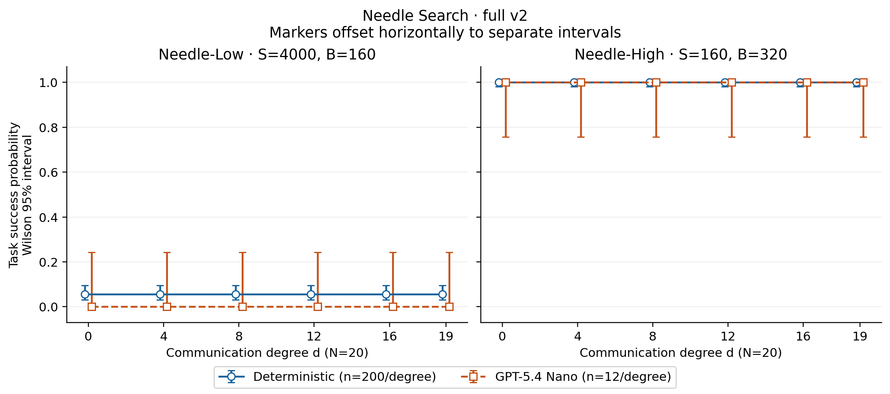
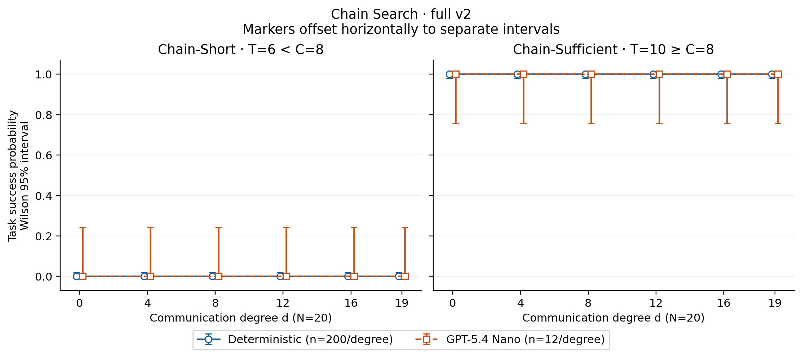
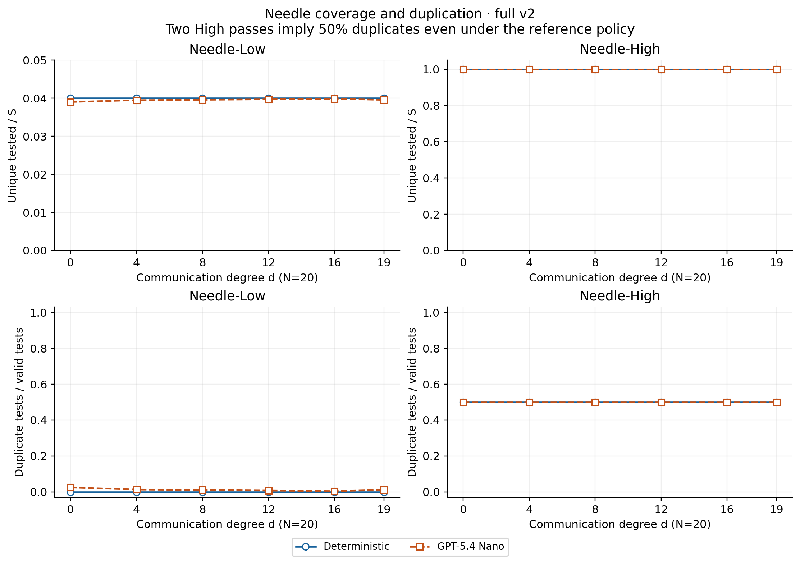
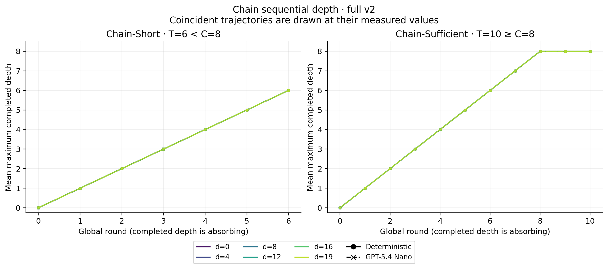
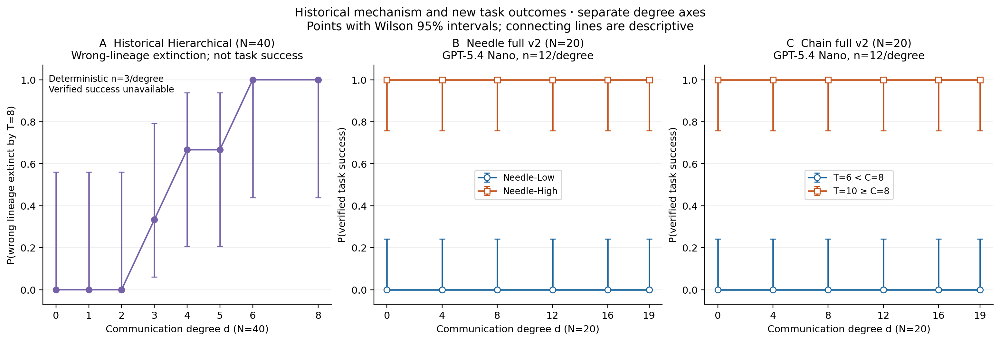

# Needle / Chain full v2 experiment

**Scientific classification: CONSISTENT WITH NO-TRANSITION THEORY.** This is the full experiment, not a pilot.

`FULL_V2_PREREGISTRATION_SHA = c9246bf47a2f107e79413be6e9f4bda3e3ae9f78`

## Objective and frozen implementation

Test whether verified task success shows an interior low-to-high crossover across communication degree in Needle and Chain Search. The [theoretical reference](https://arxiv.org/abs/2609.38327) predicts no positive finite communication threshold for Needle and a sequential resource constraint for Chain. The theoretical labels are Needle d_c=0, Chain-Short d_c=∞, and Chain-Sufficient d_c=0; these labels were not estimated from flat curves.

N=20; degrees 0,4,8,12,16,19. Deterministic seeds 92000–92199 (200/cell); GPT seeds 92000–92011 (12/cell), paired across every degree. Target, schedule and Chain RNG domains are separate; graph seed is task seed +400000. All task resources and prompts are independent of degree. Degree changes only graph-mediated, next-round neighbor observations.

| Condition | Space / length | Horizon | Batch | Nominal verification slots |
| --- | --- | --- | --- | --- |
| Needle-Low | S=4000 | 2 | 4 | 160 (4% reference coverage) |
| Needle-High | S=160 | 2 | 8 | 320 (two complete public passes) |
| Chain-Short | C=8 | 6 | 1 | 120 |
| Chain-Sufficient | C=8 | 10 | 1 | 200 maximum; 160 if completed at round 8 |

Model `gpt-5.4-nano-2026-03-17`; OpenAI chat completions, temperature 1, reasoning effort none, max output 256, concurrency 6, timeout 60 s, up to two transport retries, zero repair attempts, no per-agent API seed. The unchanged v2 High prompt recommends its schedule, while the schema permits other legal candidates. Needle success means the target was actually tested; Chain success means level 8 was completed by the horizon. Chain advancement is at most one level per global round. Needle runs both rounds even after first discovery.

See `config.json`, `provider_settings.json`, `full_v2_freeze.json`, `data_audit.json`, `validation.json`, `hosted_provenance.json` and the frozen preregistration for exact settings and checks. Completed calls and episodes are checkpointed; no behavioral failures are selectively rerun. All scheduled outcomes, including API-error episodes, remain in denominators.

## Primary success probabilities

The table directly reports P_success(d); intervals are marginal 95% Wilson intervals. D=deterministic, G=GPT. Mean rounds means rounds executed, including both Needle passes; API error is the fraction of episodes with at least one terminal model-decision error, distinct from retried transport attempts.

| Condition | Agent | d | n | Successes | P_success | 95% CI | Mean rounds | Invalid rate | API-error fraction |
| --- | --- | --- | --- | --- | --- | --- | --- | --- | --- |
| Chain-Short-Horizon | D | 0 | 200 | 0 | 0 | [0, 0.018845] | 6 | 0 | 0 |
| Chain-Short-Horizon | D | 4 | 200 | 0 | 0 | [0, 0.018845] | 6 | 0 | 0 |
| Chain-Short-Horizon | D | 8 | 200 | 0 | 0 | [0, 0.018845] | 6 | 0 | 0 |
| Chain-Short-Horizon | D | 12 | 200 | 0 | 0 | [0, 0.018845] | 6 | 0 | 0 |
| Chain-Short-Horizon | D | 16 | 200 | 0 | 0 | [0, 0.018845] | 6 | 0 | 0 |
| Chain-Short-Horizon | D | 19 | 200 | 0 | 0 | [0, 0.018845] | 6 | 0 | 0 |
| Chain-Short-Horizon | G | 0 | 12 | 0 | 0 | [0, 0.24249] | 6 | 0 | 0 |
| Chain-Short-Horizon | G | 4 | 12 | 0 | 0 | [0, 0.24249] | 6 | 0 | 0 |
| Chain-Short-Horizon | G | 8 | 12 | 0 | 0 | [0, 0.24249] | 6 | 0 | 0 |
| Chain-Short-Horizon | G | 12 | 12 | 0 | 0 | [0, 0.24249] | 6 | 0 | 0 |
| Chain-Short-Horizon | G | 16 | 12 | 0 | 0 | [0, 0.24249] | 6 | 0.00069444 | 0 |
| Chain-Short-Horizon | G | 19 | 12 | 0 | 0 | [0, 0.24249] | 6 | 0 | 0 |
| Chain-Sufficient-Horizon | D | 0 | 200 | 200 | 1 | [0.98115, 1] | 8 | 0 | 0 |
| Chain-Sufficient-Horizon | D | 4 | 200 | 200 | 1 | [0.98115, 1] | 8 | 0 | 0 |
| Chain-Sufficient-Horizon | D | 8 | 200 | 200 | 1 | [0.98115, 1] | 8 | 0 | 0 |
| Chain-Sufficient-Horizon | D | 12 | 200 | 200 | 1 | [0.98115, 1] | 8 | 0 | 0 |
| Chain-Sufficient-Horizon | D | 16 | 200 | 200 | 1 | [0.98115, 1] | 8 | 0 | 0 |
| Chain-Sufficient-Horizon | D | 19 | 200 | 200 | 1 | [0.98115, 1] | 8 | 0 | 0 |
| Chain-Sufficient-Horizon | G | 0 | 12 | 12 | 1 | [0.75751, 1] | 8 | 0.0015625 | 0 |
| Chain-Sufficient-Horizon | G | 4 | 12 | 12 | 1 | [0.75751, 1] | 8 | 0 | 0 |
| Chain-Sufficient-Horizon | G | 8 | 12 | 12 | 1 | [0.75751, 1] | 8 | 0 | 0 |
| Chain-Sufficient-Horizon | G | 12 | 12 | 12 | 1 | [0.75751, 1] | 8 | 0 | 0 |
| Chain-Sufficient-Horizon | G | 16 | 12 | 12 | 1 | [0.75751, 1] | 8 | 0 | 0 |
| Chain-Sufficient-Horizon | G | 19 | 12 | 12 | 1 | [0.75751, 1] | 8 | 0 | 0 |
| Needle-High | D | 0 | 200 | 200 | 1 | [0.98115, 1] | 2 | 0 | 0 |
| Needle-High | D | 4 | 200 | 200 | 1 | [0.98115, 1] | 2 | 0 | 0 |
| Needle-High | D | 8 | 200 | 200 | 1 | [0.98115, 1] | 2 | 0 | 0 |
| Needle-High | D | 12 | 200 | 200 | 1 | [0.98115, 1] | 2 | 0 | 0 |
| Needle-High | D | 16 | 200 | 200 | 1 | [0.98115, 1] | 2 | 0 | 0 |
| Needle-High | D | 19 | 200 | 200 | 1 | [0.98115, 1] | 2 | 0 | 0 |
| Needle-High | G | 0 | 12 | 12 | 1 | [0.75751, 1] | 2 | 0 | 0 |
| Needle-High | G | 4 | 12 | 12 | 1 | [0.75751, 1] | 2 | 0 | 0 |
| Needle-High | G | 8 | 12 | 12 | 1 | [0.75751, 1] | 2 | 0 | 0 |
| Needle-High | G | 12 | 12 | 12 | 1 | [0.75751, 1] | 2 | 0 | 0 |
| Needle-High | G | 16 | 12 | 12 | 1 | [0.75751, 1] | 2 | 0 | 0 |
| Needle-High | G | 19 | 12 | 12 | 1 | [0.75751, 1] | 2 | 0 | 0 |
| Needle-Low | D | 0 | 200 | 11 | 0.055 | [0.030985, 0.095787] | 2 | 0 | 0 |
| Needle-Low | D | 4 | 200 | 11 | 0.055 | [0.030985, 0.095787] | 2 | 0 | 0 |
| Needle-Low | D | 8 | 200 | 11 | 0.055 | [0.030985, 0.095787] | 2 | 0 | 0 |
| Needle-Low | D | 12 | 200 | 11 | 0.055 | [0.030985, 0.095787] | 2 | 0 | 0 |
| Needle-Low | D | 16 | 200 | 11 | 0.055 | [0.030985, 0.095787] | 2 | 0 | 0 |
| Needle-Low | D | 19 | 200 | 11 | 0.055 | [0.030985, 0.095787] | 2 | 0 | 0 |
| Needle-Low | G | 0 | 12 | 0 | 0 | [0, 0.24249] | 2 | 0 | 0 |
| Needle-Low | G | 4 | 12 | 0 | 0 | [0, 0.24249] | 2 | 0 | 0 |
| Needle-Low | G | 8 | 12 | 0 | 0 | [0, 0.24249] | 2 | 0 | 0 |
| Needle-Low | G | 12 | 12 | 0 | 0 | [0, 0.24249] | 2 | 0 | 0 |
| Needle-Low | G | 16 | 12 | 0 | 0 | [0, 0.24249] | 2 | 0 | 0 |
| Needle-Low | G | 19 | 12 | 0 | 0 | [0, 0.24249] | 2 | 0 | 0 |

### Deterministic results

Needle-Low: 11/200, 11/200, 11/200, 11/200, 11/200, 11/200 in ascending degree order; Needle-High: 200/200, 200/200, 200/200, 200/200, 200/200, 200/200 in ascending degree order; Chain-Short-Horizon: 0/200, 0/200, 0/200, 0/200, 0/200, 0/200 in ascending degree order; Chain-Sufficient-Horizon: 200/200, 200/200, 200/200, 200/200, 200/200, 200/200 in ascending degree order.

### GPT results

Needle-Low: 0/12, 0/12, 0/12, 0/12, 0/12, 0/12 in ascending degree order; Needle-High: 12/12, 12/12, 12/12, 12/12, 12/12, 12/12 in ascending degree order; Chain-Short-Horizon: 0/12, 0/12, 0/12, 0/12, 0/12, 0/12 in ascending degree order; Chain-Sufficient-Horizon: 12/12, 12/12, 12/12, 12/12, 12/12, 12/12 in ascending degree order.

The deterministic Needle-Low probability is 0.04 by construction, but the realized success fraction over 200 fixed seeds is a sample estimate. Its Wilson interval, rather than exact equality to 0.04, describes this sampling variation; seeds were not replaced.

Within the 12 preregistered task seeds shared with GPT, the reference Needle-Low policy succeeded on 0/12 tasks. Rare-event sampling limits interpretation of the GPT Low success cells; coverage and schedule departures provide additional behavioral measurements.

## Paired endpoints and degree-effect models

ΔP=P_success(19)−P_success(0). The bootstrap resamples whole seed pairs (1,000 replicates). The conservative interval subtracts Bonferroni 97.5% marginal Wilson intervals; it remains informative about uncertainty when a paired bootstrap collapses to [0,0]. McNemar exact discordance tests and estimable cluster-robust logistic slope tests form one BH family. A null result is not proof of equality. Logistic likelihood/AIC are descriptive Bernoulli working-model comparisons, with uncertainty clustered by task seed.

| Condition | Agent | Pairs | ΔP | Bootstrap 95% | Conservative 95% | Discordant | p | BH q |
| --- | --- | --- | --- | --- | --- | --- | --- | --- |
| Chain-Short-Horizon | deterministic | 200 | 0 | [0, 0] | [-0.024504, 0.024504] | 0 | 1 | 1 |
| Chain-Short-Horizon | llm | 12 | 0 | [0, 0] | [-0.29511, 0.29511] | 0 | 1 | 1 |
| Chain-Sufficient-Horizon | deterministic | 200 | 0 | [0, 0] | [-0.024504, 0.024504] | 0 | 1 | 1 |
| Chain-Sufficient-Horizon | llm | 12 | 0 | [0, 0] | [-0.29511, 0.29511] | 0 | 1 | 1 |
| Needle-High | deterministic | 200 | 0 | [0, 0] | [-0.024504, 0.024504] | 0 | 1 | 1 |
| Needle-High | llm | 12 | 0 | [0, 0] | [-0.29511, 0.29511] | 0 | 1 | 1 |
| Needle-Low | deterministic | 200 | 0 | [0, 0] | [-0.074632, 0.074632] | 0 | 1 | 1 |
| Needle-Low | llm | 12 | 0 | [0, 0] | [-0.29511, 0.29511] | 0 | 1 | 1 |

| Condition | Agent | Slope / degree | Cluster SE | Cluster bootstrap 95% | LL constant / degree | AIC constant / degree | p / q | Status |
| --- | --- | --- | --- | --- | --- | --- | --- | --- |
| Chain-Short-Horizon | deterministic | NA | NA | NA | [NA, NA] | [NA, NA] | [NA, NA] | not_identifiable_constant_outcome |
| Chain-Short-Horizon | llm | NA | NA | NA | [NA, NA] | [NA, NA] | [NA, NA] | not_identifiable_constant_outcome |
| Chain-Sufficient-Horizon | deterministic | NA | NA | NA | [NA, NA] | [NA, NA] | [NA, NA] | not_identifiable_constant_outcome |
| Chain-Sufficient-Horizon | llm | NA | NA | NA | [NA, NA] | [NA, NA] | [NA, NA] | not_identifiable_constant_outcome |
| Needle-High | deterministic | NA | NA | NA | [NA, NA] | [NA, NA] | [NA, NA] | not_identifiable_constant_outcome |
| Needle-High | llm | NA | NA | NA | [NA, NA] | [NA, NA] | [NA, NA] | not_identifiable_constant_outcome |
| Needle-Low | deterministic | -2.3073e-16 | 1.6285e-16 | NA | [-255.58, -255.58] | [513.16, 515.16] | [NA, NA] | estimated |
| Needle-Low | llm | NA | NA | NA | [NA, NA] | [NA, NA] | [NA, NA] | not_identifiable_constant_outcome |

For constant outcomes, degree slope is not identifiable because outcome is constant. No finite slope, inferential p-value or finite critical degree is manufactured. Conditional bootstrap estimates and reasons for unreliable intervals are retained in `diagnostics.json`. Twelve GPT clusters provide limited inferential precision.

## Explicit crossover diagnostic

Preregistered descriptive low≤0.2 and high≥0.8 thresholds classify the observed curves. Credible crossover additionally requires at least 75% paired seeds changing failure→success between an ordered low/high degree pair and exploratory BH q≤0.05 across all ordered-pair tests. This is distinct from the primary endpoint/slope BH family. No finite d_c is fitted.

| Condition | Agent | Classification | Observed range | Credible paired crossover | Brackets |
| --- | --- | --- | --- | --- | --- |
| Chain-Short-Horizon | deterministic | LOW-SATURATED | 0 | False | [] |
| Chain-Short-Horizon | llm | LOW-SATURATED | 0 | False | [] |
| Chain-Sufficient-Horizon | deterministic | HIGH-SATURATED | 0 | False | [] |
| Chain-Sufficient-Horizon | llm | HIGH-SATURATED | 0 | False | [] |
| Needle-High | deterministic | HIGH-SATURATED | 0 | False | [] |
| Needle-High | llm | HIGH-SATURATED | 0 | False | [] |
| Needle-Low | deterministic | LOW-SATURATED | 0 | False | [] |
| Needle-Low | llm | LOW-SATURATED | 0 | False | [] |

## Needle mechanism results

Unique coverage counts actual valid tests. Duplicate fraction counts repeats over all valid tests, including the deliberate second High pass. Schedule departures use multiset differences, so merely reordering a batch is not a departure. Target-batch following is the fraction of target-containing scheduled batches whose complete multiset was executed; actual target testing is reported separately. Neighbor retests count valid tests of a candidate already reported in the agent's received evidence for that round. The neighbor fraction uses valid tests made with nonempty neighbor candidate evidence as denominator; NA means no evidence. These are observable associations, not inferred model motives or causal communication effects.

| Condition | Agent | d | Unique | Coverage | Duplicates | Dup. fraction | Departure fraction | Target batch followed | Target tested |
| --- | --- | --- | --- | --- | --- | --- | --- | --- | --- |
| Needle-High | deterministic | 0 | 160 | 1 | 160 | 0.5 | 0 | 1 | 1 |
| Needle-High | deterministic | 4 | 160 | 1 | 160 | 0.5 | 0 | 1 | 1 |
| Needle-High | deterministic | 8 | 160 | 1 | 160 | 0.5 | 0 | 1 | 1 |
| Needle-High | deterministic | 12 | 160 | 1 | 160 | 0.5 | 0 | 1 | 1 |
| Needle-High | deterministic | 16 | 160 | 1 | 160 | 0.5 | 0 | 1 | 1 |
| Needle-High | deterministic | 19 | 160 | 1 | 160 | 0.5 | 0 | 1 | 1 |
| Needle-High | llm | 0 | 160 | 1 | 160 | 0.5 | 0 | 1 | 1 |
| Needle-High | llm | 4 | 160 | 1 | 160 | 0.5 | 0 | 1 | 1 |
| Needle-High | llm | 8 | 160 | 1 | 160 | 0.5 | 0.00026042 | 0.95833 | 1 |
| Needle-High | llm | 12 | 160 | 1 | 160 | 0.5 | 0.0041667 | 1 | 1 |
| Needle-High | llm | 16 | 160 | 1 | 160 | 0.5 | 0.0041667 | 1 | 1 |
| Needle-High | llm | 19 | 160 | 1 | 160 | 0.5 | 0.010417 | 0.95833 | 1 |
| Needle-Low | deterministic | 0 | 160 | 0.04 | 0 | 0 | 0 | 1 | 0.055 |
| Needle-Low | deterministic | 4 | 160 | 0.04 | 0 | 0 | 0 | 1 | 0.055 |
| Needle-Low | deterministic | 8 | 160 | 0.04 | 0 | 0 | 0 | 1 | 0.055 |
| Needle-Low | deterministic | 12 | 160 | 0.04 | 0 | 0 | 0 | 1 | 0.055 |
| Needle-Low | deterministic | 16 | 160 | 0.04 | 0 | 0 | 0 | 1 | 0.055 |
| Needle-Low | deterministic | 19 | 160 | 0.04 | 0 | 0 | 0 | 1 | 0.055 |
| Needle-Low | llm | 0 | 156.08 | 0.039021 | 3.9167 | 0.024479 | 0.058333 | NA | 0 |
| Needle-Low | llm | 4 | 157.92 | 0.039479 | 2.0833 | 0.013021 | 0.039583 | NA | 0 |
| Needle-Low | llm | 8 | 158.33 | 0.039583 | 1.6667 | 0.010417 | 0.036979 | NA | 0 |
| Needle-Low | llm | 12 | 158.83 | 0.039708 | 1.1667 | 0.0072917 | 0.029167 | NA | 0 |
| Needle-Low | llm | 16 | 159.33 | 0.039833 | 0.66667 | 0.0041667 | 0.041146 | NA | 0 |
| Needle-Low | llm | 19 | 158.25 | 0.039563 | 1.75 | 0.010938 | 0.046354 | NA | 0 |

| Condition | Agent | d | Neighbor retests | Known negative | Known target | Neighbor fraction | Round 1 / episodes | Round 2 / episodes |
| --- | --- | --- | --- | --- | --- | --- | --- | --- |
| Needle-High | deterministic | 0 | 0 | 0 | 0 | NA | 1 | 0 |
| Needle-High | deterministic | 4 | 6422 | 6371 | 51 | 0.20069 | 1 | 0 |
| Needle-High | deterministic | 8 | 12726 | 12640 | 86 | 0.39769 | 1 | 0 |
| Needle-High | deterministic | 12 | 19267 | 19152 | 115 | 0.60209 | 1 | 0 |
| Needle-High | deterministic | 16 | 25593 | 25425 | 168 | 0.79978 | 1 | 0 |
| Needle-High | deterministic | 19 | 30476 | 30284 | 192 | 0.95237 | 1 | 0 |
| Needle-High | llm | 0 | 0 | 0 | 0 | NA | 1 | 0 |
| Needle-High | llm | 4 | 370 | 366 | 4 | 0.19271 | 1 | 0 |
| Needle-High | llm | 8 | 772 | 767 | 5 | 0.40208 | 1 | 0 |
| Needle-High | llm | 12 | 1133 | 1128 | 5 | 0.5901 | 1 | 0 |
| Needle-High | llm | 16 | 1526 | 1518 | 8 | 0.79479 | 1 | 0 |
| Needle-High | llm | 19 | 1826 | 1816 | 10 | 0.95104 | 1 | 0 |
| Needle-Low | deterministic | 0 | 0 | 0 | 0 | NA | 0.035 | 0.02 |
| Needle-Low | deterministic | 4 | 0 | 0 | 0 | 0 | 0.035 | 0.02 |
| Needle-Low | deterministic | 8 | 0 | 0 | 0 | 0 | 0.035 | 0.02 |
| Needle-Low | deterministic | 12 | 0 | 0 | 0 | 0 | 0.035 | 0.02 |
| Needle-Low | deterministic | 16 | 0 | 0 | 0 | 0 | 0.035 | 0.02 |
| Needle-Low | deterministic | 19 | 0 | 0 | 0 | 0 | 0.035 | 0.02 |
| Needle-Low | llm | 0 | 0 | 0 | 0 | NA | 0 | 0 |
| Needle-Low | llm | 4 | 1 | 1 | 0 | 0.0010417 | 0 | 0 |
| Needle-Low | llm | 8 | 3 | 3 | 0 | 0.003125 | 0 | 0 |
| Needle-Low | llm | 12 | 0 | 0 | 0 | 0 | 0 | 0 |
| Needle-Low | llm | 16 | 2 | 2 | 0 | 0.0020833 | 0 | 0 |
| Needle-Low | llm | 19 | 6 | 6 | 0 | 0.00625 | 0 | 0 |

The opportunity to count a neighbor-reported retest increases with the number of received neighbor records. In the two-pass High design, a reference agent repeats every candidate regardless of communication, so an increasing neighbor-retest fraction can coexist with unchanged total duplication. This opportunity effect and the logged schedule departures must be distinguished from claims about model motive or causal changes in efficiency.

### Needle-High positive control

GPT successes: 72/72; round 1 discoveries: 72; round 2 discoveries: 0. Among successes, round 1 fraction=1, round 2 fraction=0. The second pass rescued 0 first-round omissions (0 of episodes). Per-degree fractions are in `needle_mechanisms.csv`; discovery rounds for every episode are in `needle_episodes.csv`.

This is a saturated positive-control regime showing whether success remains high throughout the communication-degree scan when resources are sufficient. Smooth coverage or duplication changes are compatible with no phase transition.

The high-resource condition is saturated before communication feedback becomes relevant and therefore serves primarily as a positive control rather than an identification of communication's causal effect.

## Chain mechanism results

Depth trajectories are exported in `depth_by_round.csv` and Figure 4. Completed depth remains absorbing for display after early termination. Each observed round is checked for an increase of at most one; future-key guesses cannot bypass the level lock.

| Condition | Agent | d | Mean max depth | Max depth | Illegal future attempts | Mean completion round (successes) |
| --- | --- | --- | --- | --- | --- | --- |
| Chain-Short-Horizon | deterministic | 0 | 6 | 6 | 0 | NA |
| Chain-Short-Horizon | deterministic | 4 | 6 | 6 | 0 | NA |
| Chain-Short-Horizon | deterministic | 8 | 6 | 6 | 0 | NA |
| Chain-Short-Horizon | deterministic | 12 | 6 | 6 | 0 | NA |
| Chain-Short-Horizon | deterministic | 16 | 6 | 6 | 0 | NA |
| Chain-Short-Horizon | deterministic | 19 | 6 | 6 | 0 | NA |
| Chain-Short-Horizon | llm | 0 | 6 | 6 | 0 | NA |
| Chain-Short-Horizon | llm | 4 | 6 | 6 | 0 | NA |
| Chain-Short-Horizon | llm | 8 | 6 | 6 | 0 | NA |
| Chain-Short-Horizon | llm | 12 | 6 | 6 | 0 | NA |
| Chain-Short-Horizon | llm | 16 | 6 | 6 | 0 | NA |
| Chain-Short-Horizon | llm | 19 | 6 | 6 | 0 | NA |
| Chain-Sufficient-Horizon | deterministic | 0 | 8 | 8 | 0 | 8 |
| Chain-Sufficient-Horizon | deterministic | 4 | 8 | 8 | 0 | 8 |
| Chain-Sufficient-Horizon | deterministic | 8 | 8 | 8 | 0 | 8 |
| Chain-Sufficient-Horizon | deterministic | 12 | 8 | 8 | 0 | 8 |
| Chain-Sufficient-Horizon | deterministic | 16 | 8 | 8 | 0 | 8 |
| Chain-Sufficient-Horizon | deterministic | 19 | 8 | 8 | 0 | 8 |
| Chain-Sufficient-Horizon | llm | 0 | 8 | 8 | 1 | 8 |
| Chain-Sufficient-Horizon | llm | 4 | 8 | 8 | 0 | 8 |
| Chain-Sufficient-Horizon | llm | 8 | 8 | 8 | 0 | 8 |
| Chain-Sufficient-Horizon | llm | 12 | 8 | 8 | 0 | 8 |
| Chain-Sufficient-Horizon | llm | 16 | 8 | 8 | 0 | 8 |
| Chain-Sufficient-Horizon | llm | 19 | 8 | 8 | 0 | 8 |

Retained 4 invalid Chain action(s) in 2 GPT episode(s). These episodes remain in every result table. The shared chain can still advance when another agent submits a valid current-level capability; an invalid action is not itself a protocol violation. Detailed observed-action diagnostics are recorded in the independent final audit.

## Historical Hierarchical comparison

No historical model calls were made. The archived source has 24 deterministic episodes, N=40, T=8, degrees 0,1,2,3,4,5,6,8 and seeds 95000–95002, from `wenwenzheng-gif/absorb-state-new`, commit `236a8e043c433239b03ef809f607b365fc933c81`. It initializes only wrong depth-one prefixes. It records incorrect-lineage extinction and growth, not verified target recovery. Execution `status: ok` is not task success. Thus a reproducible historical P_success curve is unavailable from these records; the existing success-model utilities cannot recover an outcome never recorded.

Figure 5A honestly displays P(wrong lineage extinct by T=8), not P_success. This is a mechanism comparison, not evidence that historical task success has the same crossover. The archived lineage-growth analysis reports a crossing between d=3 and d=4 (interpolated 3.599); that is a different estimand. Panels B/C show actual new GPT task success, on separate N=20 degree axes. The older N=40 factorizable threshold tables are also not substituted for Hierarchical success. Source hashes and limitations are in `historical_provenance.json` and `data/needle_chain/historical_hierarchical/source_manifest.json`.

| Historical d | n | Extinct | P(extinction) | Wilson 95% |
| --- | --- | --- | --- | --- |
| 0 | 3 | 0 | 0 | [0, 0.5615] |
| 1 | 3 | 0 | 0 | [0, 0.5615] |
| 2 | 3 | 0 | 0 | [0, 0.5615] |
| 3 | 3 | 1 | 0.33333 | [0.061492, 0.79234] |
| 4 | 3 | 2 | 0.66667 | [0.20766, 0.93851] |
| 5 | 3 | 2 | 0.66667 | [0.20766, 0.93851] |
| 6 | 3 | 3 | 1 | [0.4385, 1] |
| 8 | 3 | 3 | 1 | [0.4385, 1] |

## Figures

PNG previews and vector PDF versions share the same numerical sources.

[Needle success, vector PDF](figures/figure_1_needle.pdf)

[Chain success, vector PDF](figures/figure_2_chain.pdf)

[Needle coverage and duplication, vector PDF](figures/figure_3_needle_mechanisms.pdf)

[Chain depth by global round, vector PDF](figures/figure_4_chain_depth.pdf)

[Historical extinction versus new verified task outcomes, vector PDF](figures/figure_5_historical_comparison.pdf)

## Runtime, calls and tokens

Measured stage wall times exclude dependency installation, tests between stages, artifact uploads and offline analysis. Transport latency is not summed as wall time because calls are concurrent. Estimated cost uses frozen rates $0.20/M uncached input, $0.02/M cached input, $1.25/M output; it is not a billing statement.

The initial operational estimate used the v2 pilot throughput: 792 calls in 124.7625 seconds, giving about 68 minutes for the 25,920-call correct-policy full workload. This estimate was not a stopping rule. The table below reports the actual full-run measurements; hosted job elapsed time, including tests, analysis and uploads, is separately recorded in `hosted_provenance.json`.

| Quantity | Measured value |
| --- | --- |
| deterministic_episodes | 4800 |
| llm_episodes | 288 |
| deterministic_seconds | 144.28 |
| llm_seconds | 3604.8 |
| api_calls | 25921 |
| successful_api_calls | 25920 |
| failed_attempts | 1 |
| retries | 1 |
| mean_http_latency_seconds | 0.69516 |
| episodes_per_minute | 4.7936 |
| calls_per_episode | 90.003 |
| prompt_tokens | 42988600 |
| completion_tokens | 907714 |
| full_executed | True |
| execution_status | complete |
| blocker | NA |
| cached_prompt_tokens | 65024 |
| estimated_cost_usd | 9.7207 |
| execution_seconds | 3843.3 |

There were 1 HTTP attempt(s) without a saved completion event. They are included in attempted-call and retry accounting. Recorded token usage and estimated cost cover saved successful responses; provider-side processing or billing for an interrupted attempt cannot be reconstructed from these logs.

## Validation, deviations and limitations

Expected episodes: 5088; observed: 5088; missing: 0. Protected pilot artifacts: unchanged; frozen design: unchanged. Response models: gpt-5.4-nano-2026-03-17. Detailed request-key, retry, source-SHA and raw-checkpoint audits are in the machine-readable validation/provenance files.

No planned task parameters, seeds, sample sizes, prompts, success criteria or model settings were changed after execution began. No exclusions or favorable behavioral reruns are permitted. The historical panel uses extinction because verified historical success is unavailable; this limitation was documented before full live execution. Any operational recovery or reporting-only corrections are recorded in `validation.json`.

The deterministic baseline is an implementation and resource check. GPT n=12 per degree cannot prove equality, excludes neither small degree effects nor unobserved transitions between sampled degrees, and is conditional on this policy, graph construction and resource allocation. At 12/12 successes the 95% Wilson lower bound is only about 0.758; at 0/12 the upper bound is about 0.242. No observed crossover is weaker than proof that none exists. Constant outcomes also limit logistic inference. High-resource saturation limits causal interpretation, while the historical panel uses a different outcome and population size.

## Conclusion

**CONSISTENT WITH NO-TRANSITION THEORY.** The classification applies the frozen regime-separation and paired-crossover rules, rather than selecting outcomes to match theory.

Across the preregistered communication-degree scan, the data are consistent with the theoretical no-finite-transition prediction and show no observed interior success crossover. This finite experiment does not prove that no transition exists under other degrees, resources or policies.

## Final independent verification and execution notes

All 5,088 episode IDs and all 48 cells passed an independent audit. All 20 frozen scientific files match the preregistration; 51 protected processed/preregistration files and 6,128 local raw pilot files are unchanged. The 4,800 reference episode files are identical to their checkpoint saved before GPT execution. The complete relevant suite passed: **502 tests, 13 skips, and 934 subtests**. All five PNG/PDF figure pairs were inspected; the PDF files are single-page vector figures. Regenerated numerical tables and uncompressed episode content match the hosted results.

Four invalid Chain actions were retained. In Chain-Short seed 92001, d=16, agent 8 submitted the current level with a mismatched capability key at round 6. In Chain-Sufficient seed 92002, d=0, agent 9 attempted a future level at round 6; the environment rejected it. That agent then lacked the current capability and made two further rejected submissions at rounds 7 and 8. Other agents advanced the shared chain, which completed at round 8. There was exactly one illegal future-level attempt and no barrier violation. These are observed action traces, not inferred model motives.

Needle-High achieved complete first-round coverage in all 72 GPT episodes. Nine episodes contained 10 changed batches, all in round 2 (73 replaced planned slots); these departures did not change target discovery because every target had already been found in round 1.

| GPT condition | Episodes | Measured seconds | HTTP attempts | Saved successes | Retries | Estimated USD |
| --- | --- | --- | --- | --- | --- | --- |
| Needle-Low | 72 | 379.020 | 2880 | 2880 | 0 | 0.7045 |
| Needle-High | 72 | 393.555 | 2880 | 2880 | 0 | 1.2266 |
| Chain-Short-Horizon | 72 | 1226.748 | 8641 | 8640 | 1 | 3.1734 |
| Chain-Sufficient-Horizon | 72 | 1605.472 | 11520 | 11520 | 0 | 4.6161 |

Hosted job elapsed time was **4943 seconds (82.38 minutes)**, including tests, analysis and artifact uploads. GPT stage execution was **3604.795 seconds (60.08 minutes)**; deterministic execution was **144.278 seconds**. The artifact checksum matches GitHub's recorded digest. The credential-pattern scan covered 67,995 text or compressed records and found no matches; credentials were not copied, printed, modified or committed.

Operational deviation: automatic approval review rejected deletion of the temporary runner branch because remote branch deletion was not explicitly authorized. That branch remains at the frozen preregistration SHA. The canonical results branch is separate, both main branches are unchanged, and this cleanup restriction has no effect on the scientific data or classification. No additional experiments were launched.
